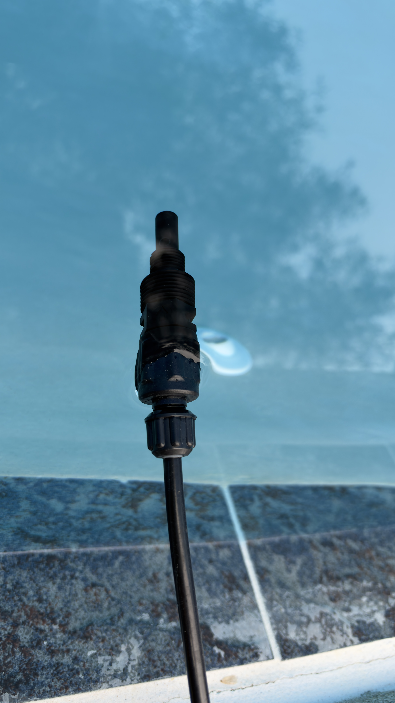
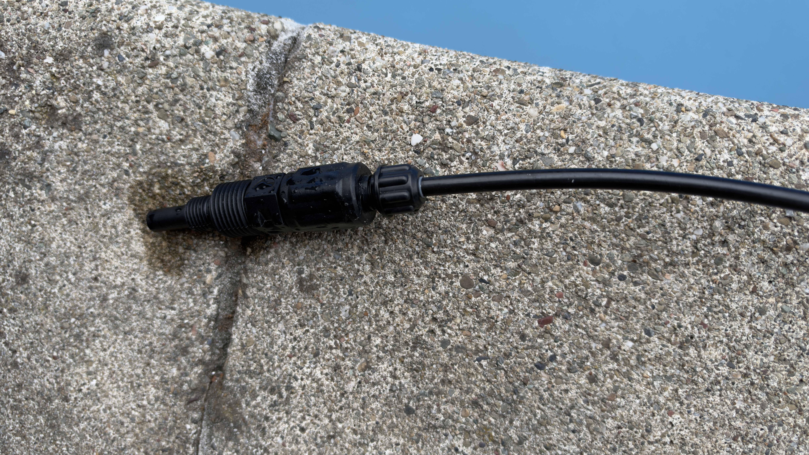
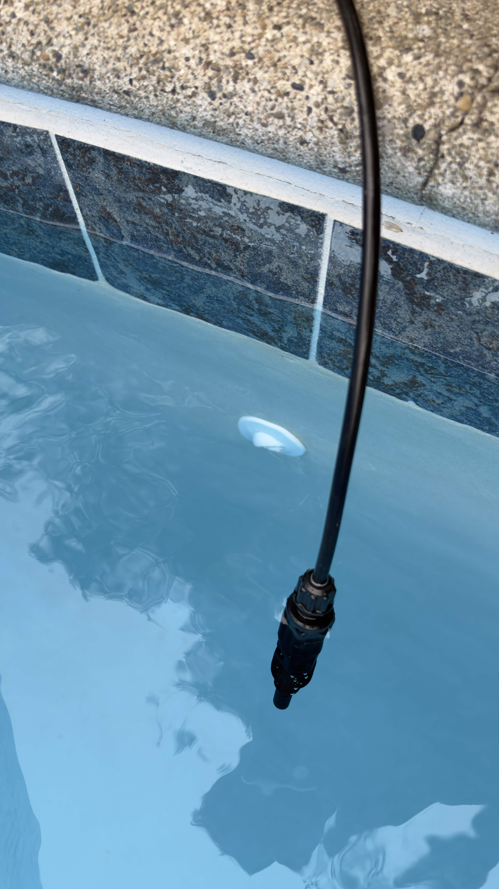
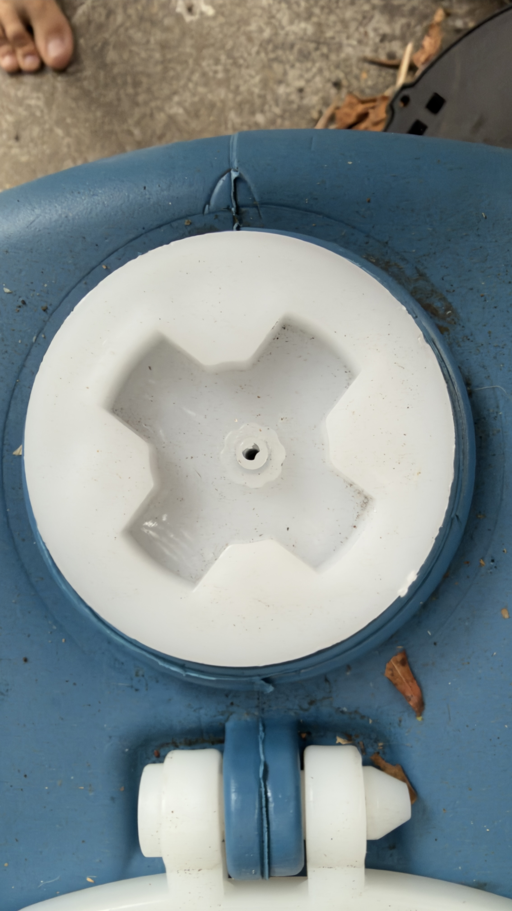
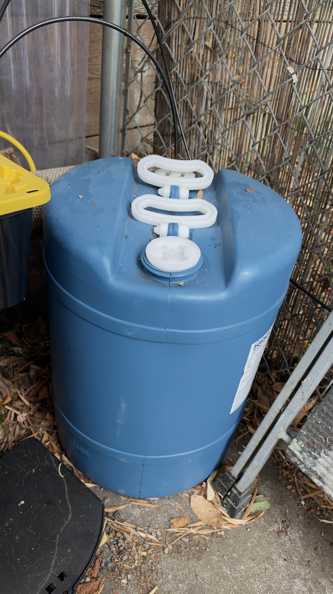
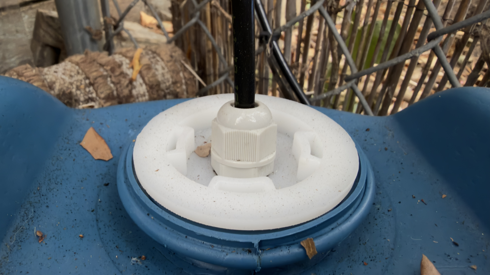
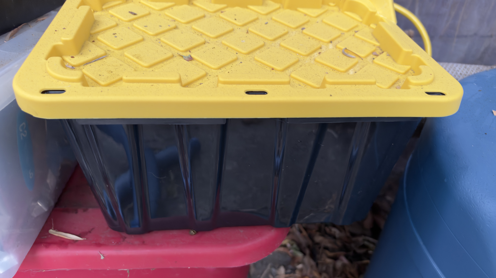
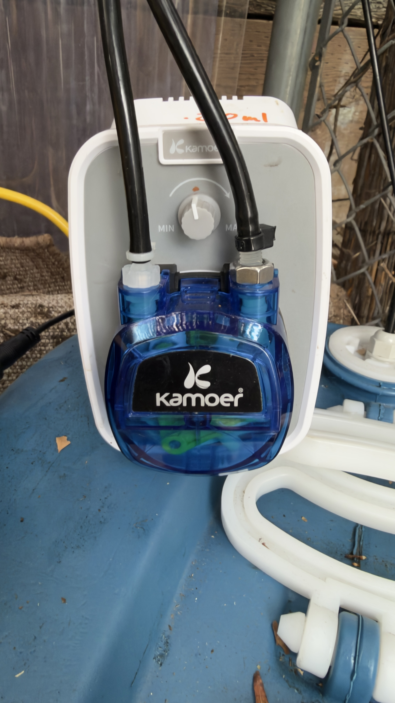
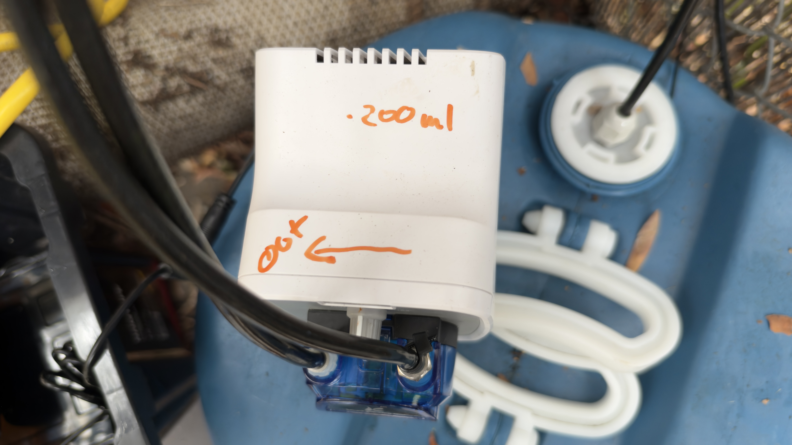
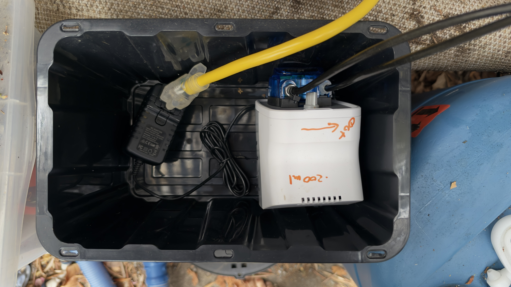

# Complete assembly photographs

The owner supplied these ten photographs as the complete assembly on October 21, 2026. They document the hardware arrangement; performance, material compatibility and electrical protection require separate specifications and tests.

The JPEG image data and dimensions are preserved. EXIF/XMP/IPTC metadata was removed from publication copies, including GPS coordinates. The source photographs are unchanged.

[Return to the tutorial](../README.md)

## Check-valve nozzle

Source: IMG_0542.jpg

Close-up of the exposed discharge nozzle and threaded valve body against the pool background. The valve is attached to the black tube by its compression connection.

## Check valve and tube connection

Source: IMG_0543.jpg

The complete check valve on the coping: tubing at the right, compression nut, valve body and discharge tip at the left. The external mounting threads are exposed.

## Direct discharge near the pool return

Source: IMG_0544.jpg

The valve hangs into the pool near a visible wall return fitting. It is not screwed into the pressurized return pipe. A permanent support for the outlet is not visible in this view.

## Fill/vent cap opening

Source: IMG_0545.jpg

Close-up of the other white cap, with an open hole at its center. The photo establishes the opening used in this build, not its dimensions or a manufacturer-approved vent specification.

## Assembled reservoir

Source: IMG_0546.jpg

The blue reservoir beside the covered equipment tote. No secondary containment tray is visible in this frame.

## Installed pickup pass-through

Source: IMG_0547.jpg

The black suction tube passes through a white compression gland mounted in a bung cap. The tank-side pickup is not visible; exact gland and seal materials still need part-level confirmation.

## Closed equipment cover

Source: IMG_0548.jpg

Black storage tote with yellow lid beside the reservoir. This documents the cover used; it does not establish an electrical enclosure or ingress rating.

## Kamoer front and tubing connections

Source: IMG_0549.jpg

Front of the Kamoer pump with its speed knob, blue pump head and two line connections. The right-hand connection has a metal-looking hex nut; the photo cannot establish whether that part is wetted.

## Outlet and calibration markings

Source: IMG_0550.jpg

The owner has marked OUT with an arrow and written 200 ml on the housing. The volume marking has no time basis and is not a measured mL/min rate.

## Pump and power adapter inside the cover

Source: IMG_0551.jpg

The open tote contains the Kamoer pump, DC adapter and power connection. The ZEN05 and any upstream GFCI protection are outside this view.

## What these photos establish

- The check valve is attached to the discharge tube and is shown submerged near a pool return, without a return-pipe tap.
- One reservoir cap carries the tube pass-through; another has a small open vent hole.
- The Kamoer has two external tube connections, a manual speed knob and an OUT marking.
- The pump and adapter are placed inside a black tote with a yellow lid.

## What still needs recording

| Detail | Why the photo is insufficient |
|---|---|
| Gland, seals and adapter materials | Appearance does not identify the resin/elastomer or determine whether the metal-looking nut is wetted. |
| Vent specification | An open hole is visible; its size, adequacy and protection from contamination are not established. |
| Containment | No containment tray is visible around the reservoir in this set. |
| Electrical and outdoor protection | The photos show a tote, not a documented rated enclosure or upstream GFCI/plug configuration. |
| Outlet retention and siphon protection | The valve is immersed and hanging from tubing; the permanent mount and any additional anti-siphon provisions are not visible. |
| Independent flow cutoff | No flow-sensing/interlock device is identifiable in this photo set. |
| Calibration | The housing says 200 ml without a duration; the later written build record says 221 mL/min. Reconcile with a timed measurement. |

The blue rim around the bungs has visible seams/notches. The photographs do not establish whether these are manufacturing features or damage; no claim of a cracked or sound pressure boundary is made from appearance alone.
