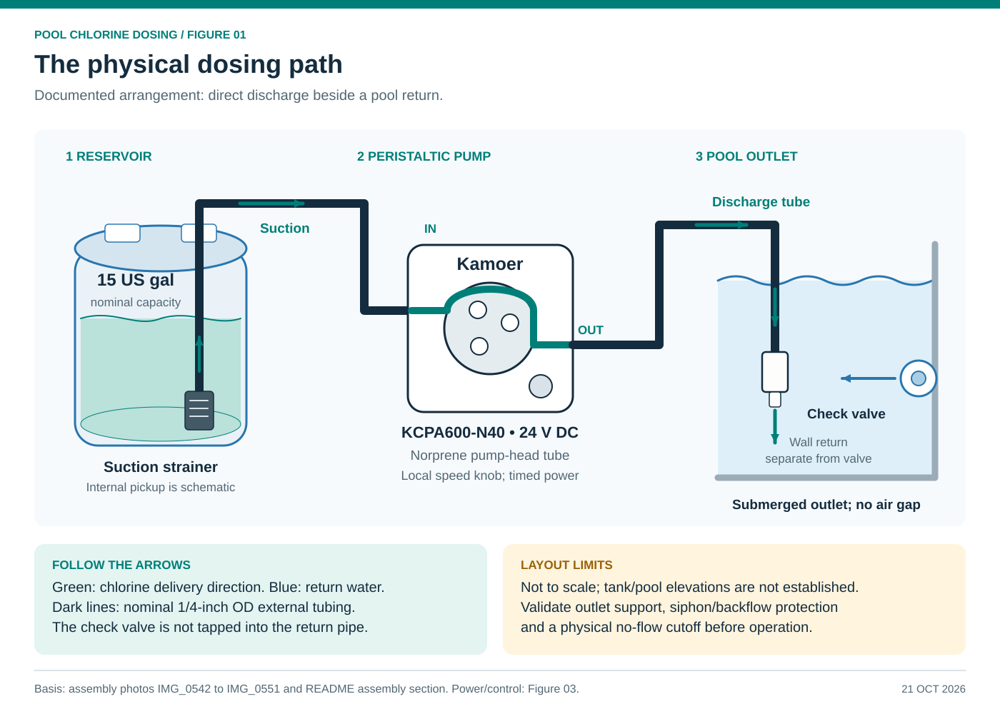
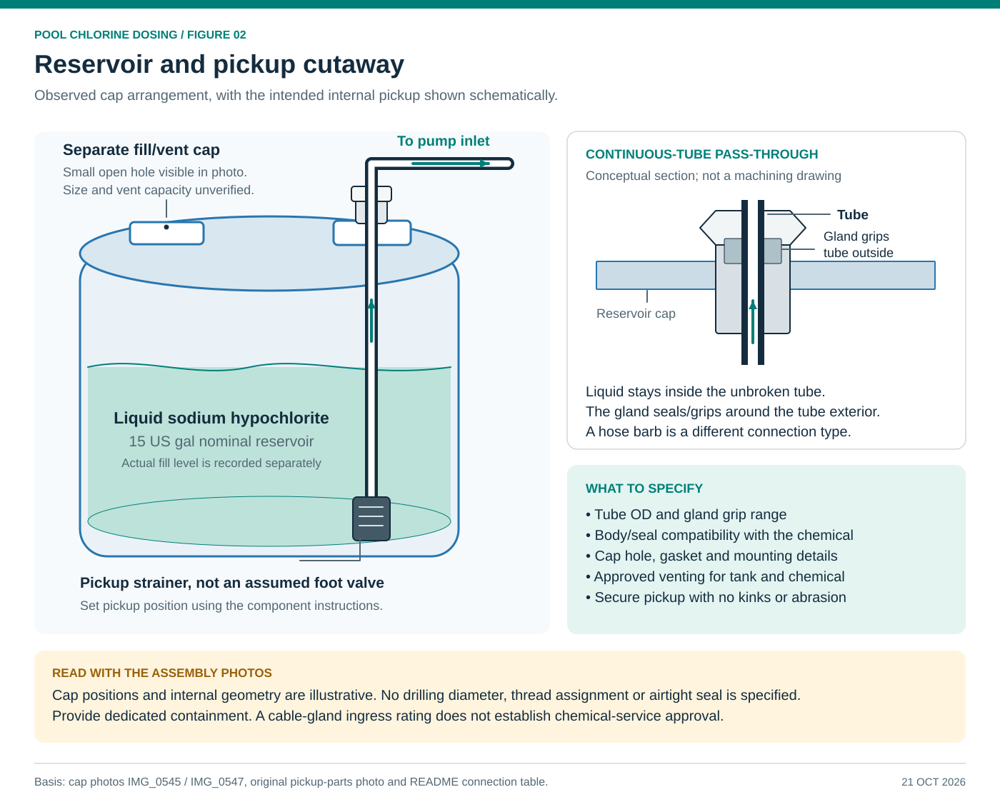
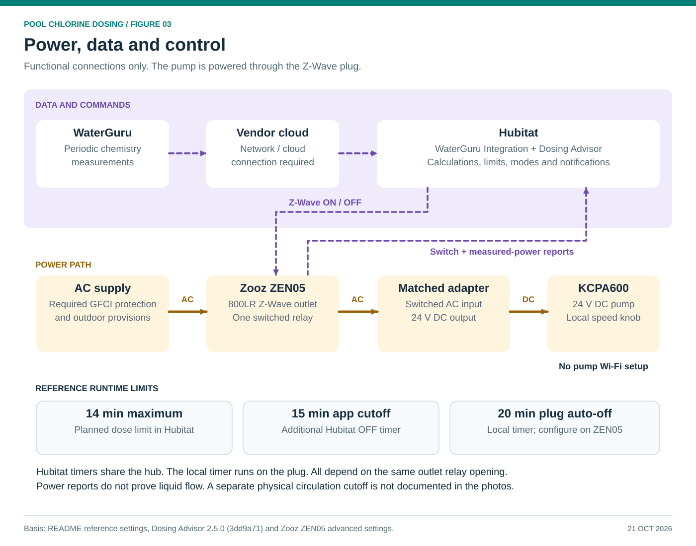
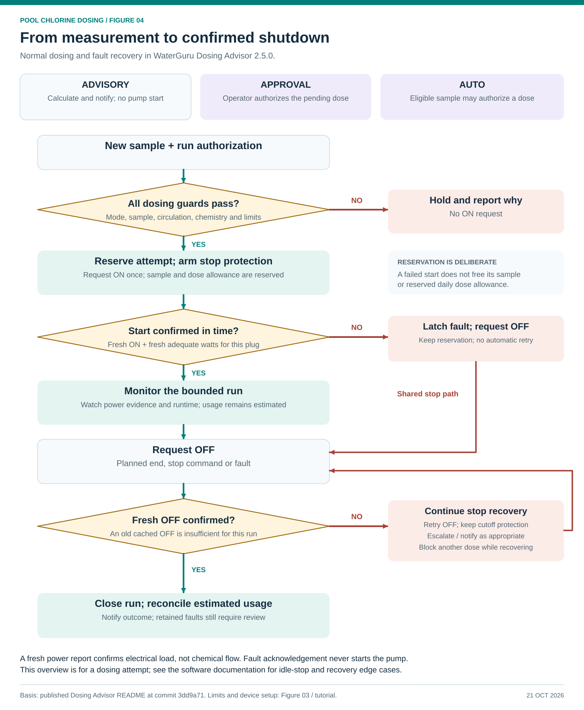

# Diagram gallery

These four diagrams accompany the pool chlorine dosing tutorial. Each is supplied as an editable SVG and a matching PNG for applications that do not display SVG. They use the same component names and control behavior as the current README.

## 1. Physical dosing layout

[SVG](../diagrams/01-system-layout.svg) · [PNG](../diagrams/01-system-layout.png)

The check valve is submerged beside a pool return and is not connected to that return's pipe. The internal pickup, relative elevations and component shapes are schematic. Dedicated containment, a suitable equipment enclosure and physical protective functions must be specified separately; the illustration does not certify them as installed.

## 2. Reservoir and pickup cutaway

[SVG](../diagrams/02-reservoir-cutaway.svg) · [PNG](../diagrams/02-reservoir-cutaway.png)

The tube stays continuous through the cap gland. Flow travels upward from the suction strainer toward the pump. The separate cap provides filling access and has a small open hole visible in the photo. The cutaway does not assert a vent diameter, gland material, thread size, cap drilling dimension or verified internal pickup placement.

## 3. Power, data and control

[SVG](../diagrams/03-power-and-control.svg) · [PNG](../diagrams/03-power-and-control.png)

WaterGuru's data connection is separate from the pump's Z-Wave power control. The pump is supplied by its matched 24 V adapter. The 14-minute planned maximum and 15-minute emergency timer run in Hubitat; the 20-minute auto-off timer is configured on the ZEN05. These are the tutorial's reference settings. All electrical stop paths still depend on the same outlet relay.

## 4. Dosing sequence

[SVG](../diagrams/04-dosing-sequence.svg) · [PNG](../diagrams/04-dosing-sequence.png)

The overview shows normal dosing and failed-start/stop-recovery paths for this power-reporting plug. It summarizes a dosing attempt; the software documents additional cases such as idle stops, late ON reports and recovery after restarts. Power confirmation does not measure liquid delivery, and usage remains an estimate.

## Source and maintenance

- Build evidence: original assembly photos IMG_0542 to IMG_0551, the pickup component photo and the [assembly instructions](../README.md#assembly).
- Software: [WaterGuru Dosing Advisor README at commit 3dd9a71](https://github.com/chsbusch-dot/hubitat-waterguru-dosing-advisor/blob/3dd9a7192682aab1ecde6031e55bdb6431e5b925/README.md), package 2.5.0.
- Plug timer and reports: [Zooz ZEN05 advanced settings](https://www.support.getzooz.com/kb/article/1118-zen05-outdoor-plug-advanced-settings/).
- Editable generation source: [build_diagrams.py](../diagrams/build_diagrams.py). It requires Python 3 and its standard library. Run `python3 diagrams/build_diagrams.py` from the tutorial root to regenerate SVGs; export updated PNGs with an SVG renderer.

Review date: October 21, 2026. Diagrams are documentation, not dimensioned fabrication drawings or an inspection of the live installation. No live Hubitat settings or pump controls were changed.
