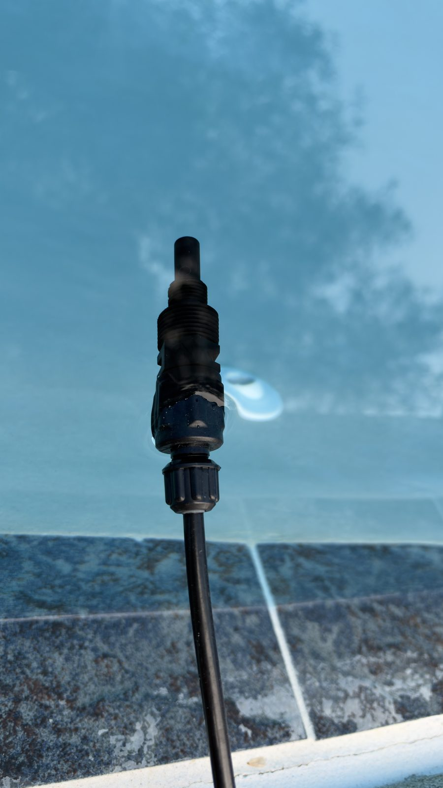
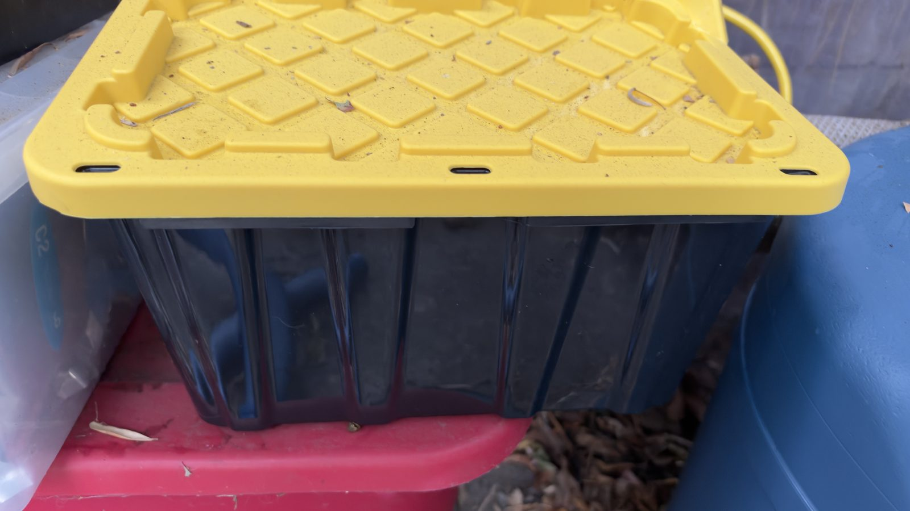
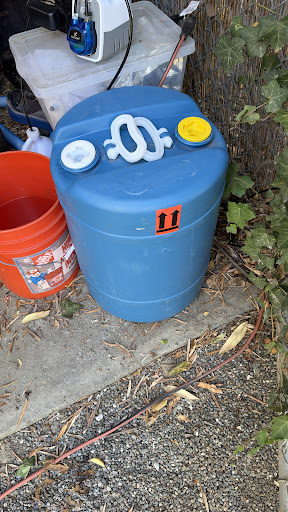
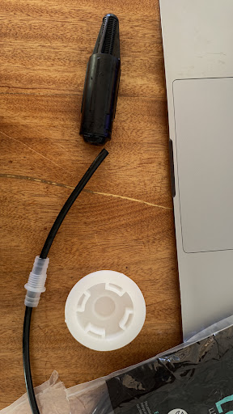

# Assembly photos

Ten photos of the finished build, taken in October 2026. They show how the parts are arranged.
They do not prove flow rates, material compatibility or electrical protection. Those need their own
specifications and tests.

The published copies are resized and have their EXIF, XMP and IPTC metadata (including GPS
coordinates) removed.

[Back to the hardware guide](hardware.md)

## Check-valve nozzle

The exposed discharge nozzle and threaded valve body, against the pool. The valve is attached to the
black tube by its compression connection.

## Check valve and tube connection

The complete check valve on the coping: tubing at the right, then the compression nut, the valve body
and the discharge tip at the left. The external mounting threads are exposed.

## Direct discharge near the pool return

The valve hangs into the pool near a wall return fitting. It is not screwed into the pressurized
return pipe. This view shows no permanent support for the outlet.

## Fill and vent cap

The second white cap, with an open hole at its center. The photo shows the opening this build uses,
not its size or a vent rating from the drum maker.

## Assembled reservoir

The blue reservoir beside the covered equipment tote. No spill containment tray is visible in this
frame.

## Installed pickup pass-through

The black suction tube passes through a white compression gland mounted in a bung cap. The pickup
inside the drum is not visible here.

## Closed equipment cover

A black storage tote with a yellow lid beside the reservoir. It is a cover, not a rated electrical
enclosure.

## Kamoer front and tubing connections

The front of the Kamoer pump: speed knob, blue pump head and two line connections. The right-hand
connection has a metal-looking hex nut. The photo cannot tell whether that part touches the
chlorine.

## Outlet and rate markings

OUT is marked with an arrow, and "200 ml" is written on the housing. That is the measured rate of
this pump at its knob setting, about 200 mL per minute (see
[Calibration](hardware.md#calibration)). Measure your own pump: the rate depends on
the knob, the tube and the lift.

## Pump and power adapter inside the cover

The open tote holds the Kamoer pump, its DC adapter and the power connection. The ZEN05 and the GFCI
protection upstream of it are outside this view.

## What the photos show

- The check valve is attached to the discharge tube and hangs submerged near a pool return. No
  return pipe is tapped.
- One reservoir cap carries the tube pass-through. The other has a small open vent hole.
- The Kamoer has two external tube connections, a manual speed knob and an OUT marking.
- The pump and adapter sit inside a black tote with a yellow lid.

## What the photos do not show

Check these on your own build. A photo cannot settle them.

| Detail | Why a photo is not enough |
|---|---|
| Gland, seal and fitting materials | Appearance does not identify a plastic or rubber, or show whether the metal-looking nut is wetted. |
| Vent | The hole is visible. Its size, whether it is enough and how it is kept clean are not. |
| Containment | No containment tray is visible around the reservoir. |
| Electrical and outdoor protection | The photos show a tote, not a rated enclosure, and not the GFCI upstream of the plug. |
| Outlet retention and siphon protection | The valve hangs from its tubing. A permanent mount or any extra anti-siphon part is not visible. |
| Flow cutoff | No flow switch or interlock appears in these photos. |

The blue rim around the bungs has visible seams and notches. The photos cannot tell whether these
are molding features or damage, so inspect your own drum before you fill it.

## Earlier build stage

Two smaller photos from September 2026, before the build was finished. They are kept for
reference and do not show the final layout.

### Reservoir before final installation

The drum with its original caps, an open bucket beside it and a clear tote behind it. Containment,
chemical labels and the final cover are not in place yet, so do not copy this arrangement.

### Suction parts before assembly

The black suction strainer, the black tube with a clear fitting on it, and a white bung cap seen
from below. The strainer is a strainer, not a foot valve. The finished build passes the tube
unbroken through a compression gland instead (see
[Installed pickup pass-through](#installed-pickup-pass-through)).
