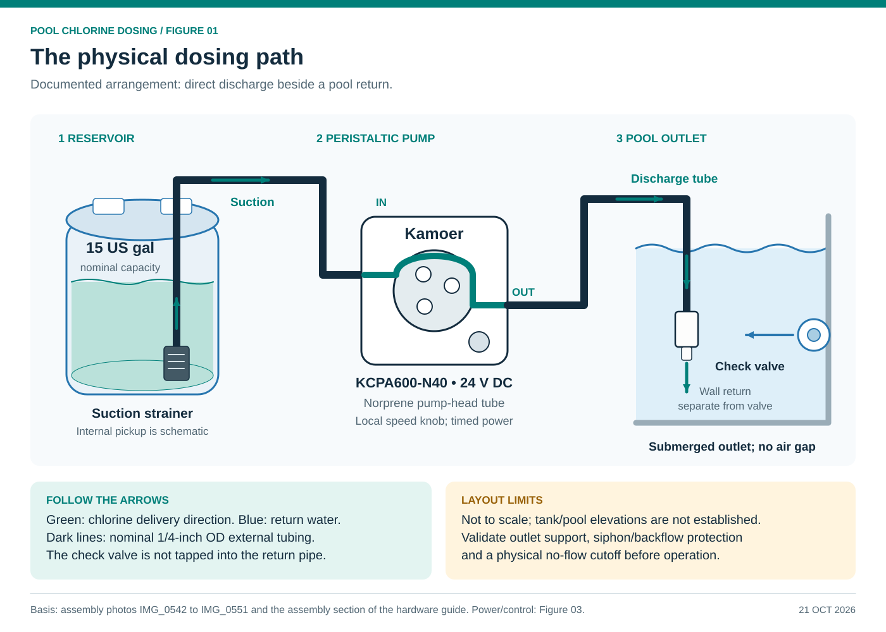
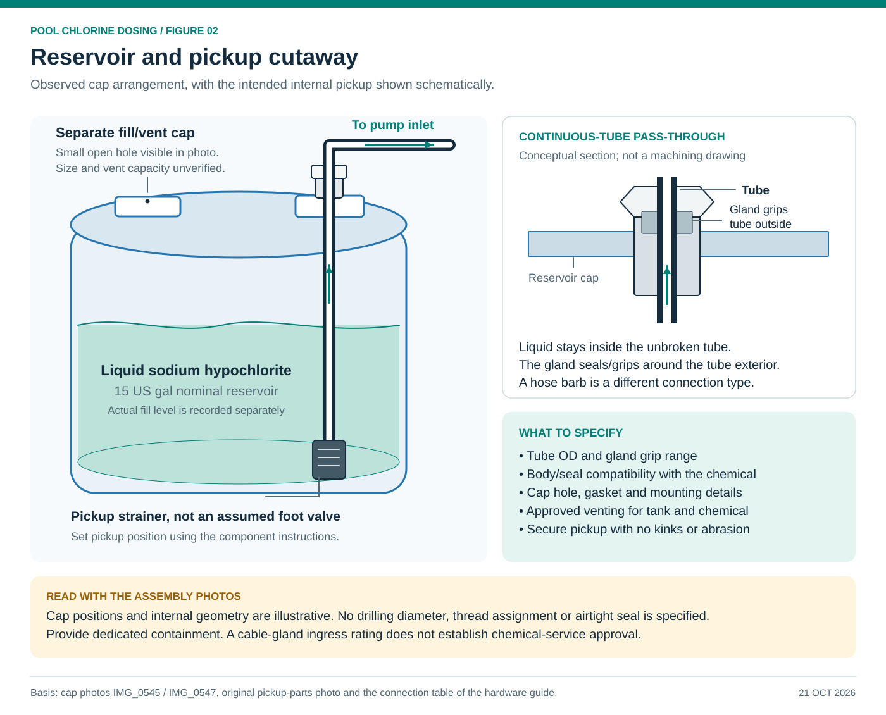
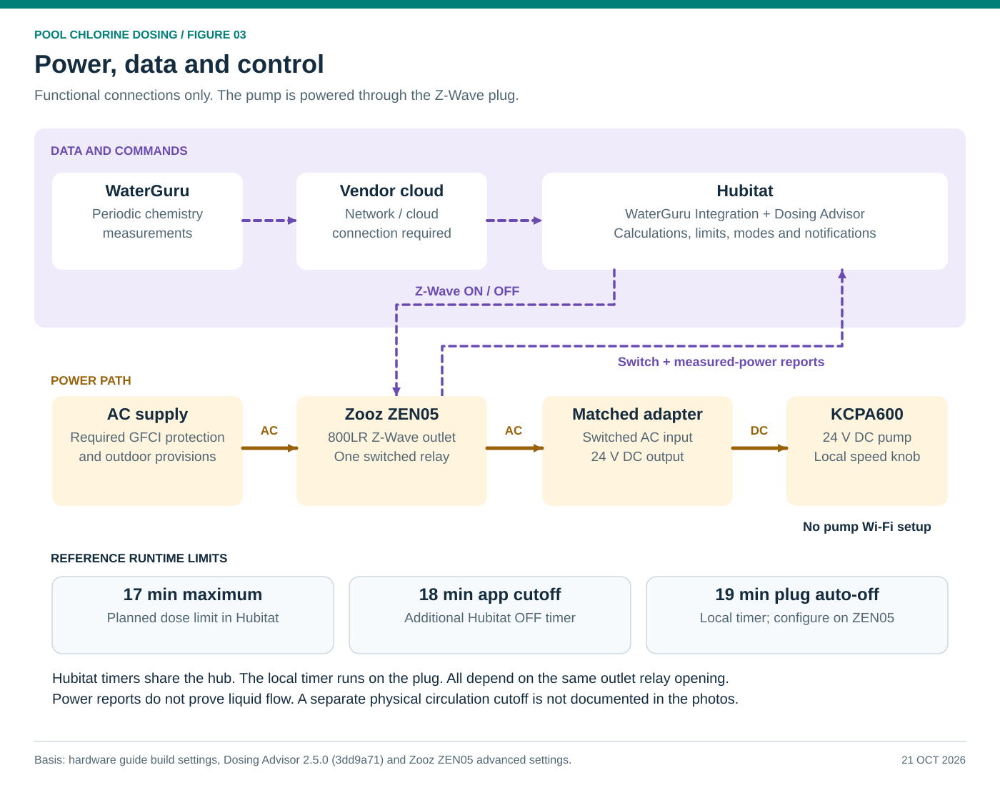

# Diagrams

Four diagrams for the [hardware guide](hardware.md). Each comes as an editable SVG and a matching
PNG for viewers that do not show SVG.

## 1. Physical dosing layout

[SVG](diagrams/01-system-layout.svg) · [PNG](diagrams/01-system-layout.png)

The check valve hangs submerged beside a pool return and is not connected to that return's pipe.
The pickup inside the drum, the heights and the shapes are schematic. Containment, an equipment
enclosure and physical safety devices have to be chosen separately. The drawing does not show them
as installed.

## 2. Reservoir and pickup cutaway

[SVG](diagrams/02-reservoir-cutaway.svg) · [PNG](diagrams/02-reservoir-cutaway.png)

The tube runs unbroken through the cap gland. Chlorine flows up from the suction strainer toward the
pump. The second cap is for filling and has a small open hole. The cutaway does not give a vent
size, gland material, thread size, drilling dimension or exact pickup position.

## 3. Power, data and control

[SVG](diagrams/03-power-and-control.svg) · [PNG](diagrams/03-power-and-control.png)

WaterGuru's data path is separate from the pump's Z-Wave power control. The pump runs from its
matched 24 V adapter. The 17 minute planned maximum and the 18 minute app cutoff run in Hubitat. The
19 minute auto-off runs on the ZEN05 itself. These are this build's settings (the app ships with
14 and 15 minutes, see [Configure the pool advisor](hardware.md#3-configure-the-pool-advisor)). Every
electrical stop still depends on the same outlet relay opening.

## 4. Dosing sequence

[SVG](diagrams/04-dosing-sequence.svg) · [PNG](diagrams/04-dosing-sequence.png)

The normal dose, a failed start and stop recovery on a plug that reports power. The software handles
more cases than this overview shows, such as idle stops, late ON reports and recovery after a hub
restart (see [Pump start confirmation and faults](software.md#pump-start-confirmation-and-faults)).
Power confirms the pump ran, not how much liquid it moved, so usage stays an estimate.

## Sources and regenerating

- Build: assembly photos IMG_0542 to IMG_0551, the pickup parts photo and the
  [assembly steps](hardware.md#assembly).
- Software: [WaterGuru Dosing Advisor 2.5.0](software.md).
- Plug timer and reports:
  [Zooz ZEN05 advanced settings](https://www.support.getzooz.com/kb/article/1118-zen05-outdoor-plug-advanced-settings/).
- Source: [build_diagrams.py](diagrams/build_diagrams.py) needs only Python 3 and its standard
  library. `python3 docs/diagrams/build_diagrams.py` rewrites the SVGs next to it. Export the PNGs
  with any SVG renderer at 1400 px wide.

The diagrams are documentation, not dimensioned fabrication drawings.
