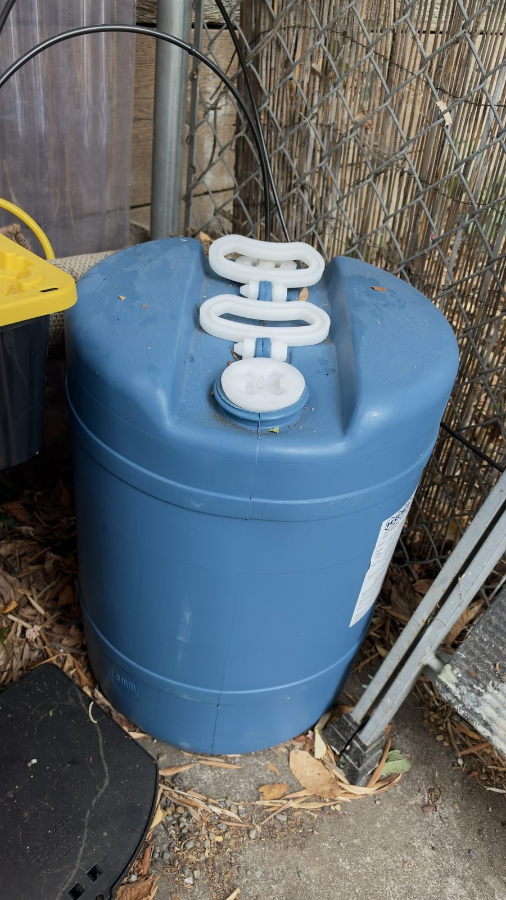
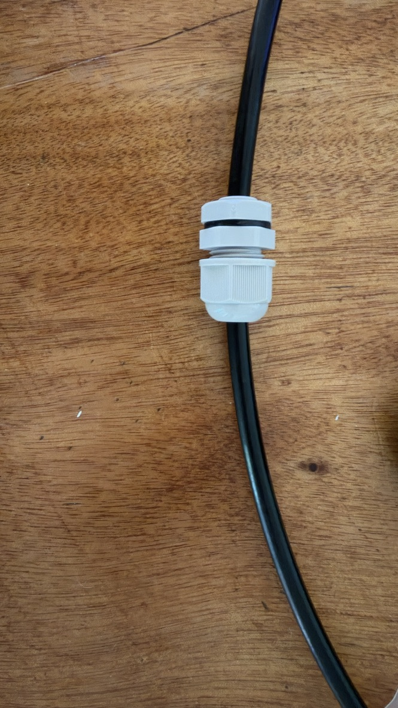
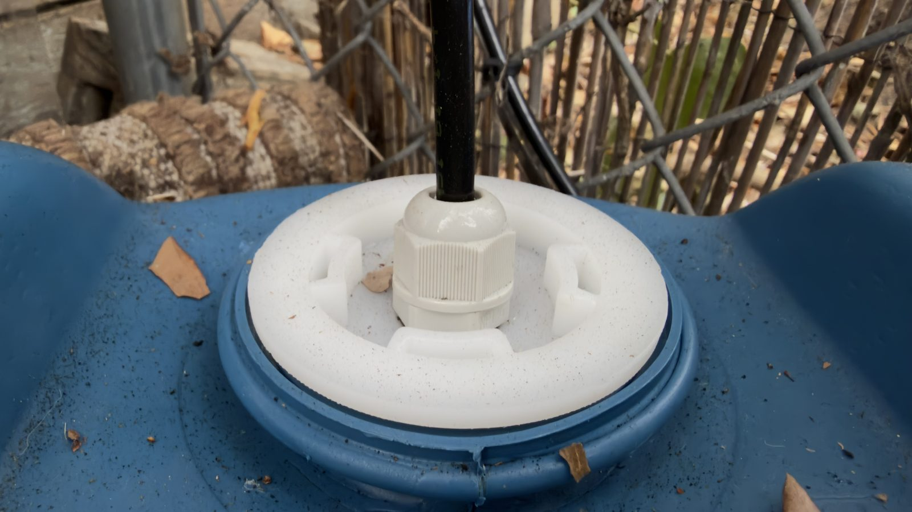
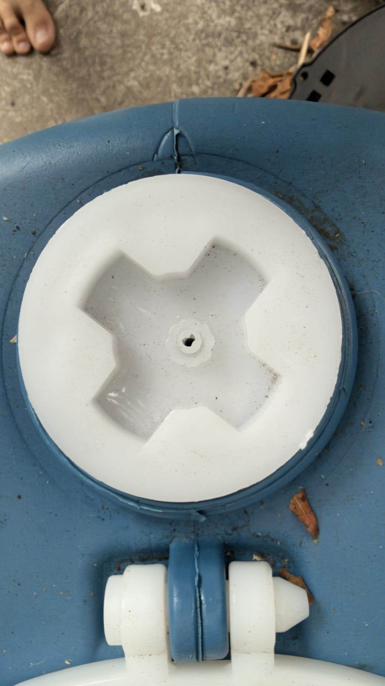
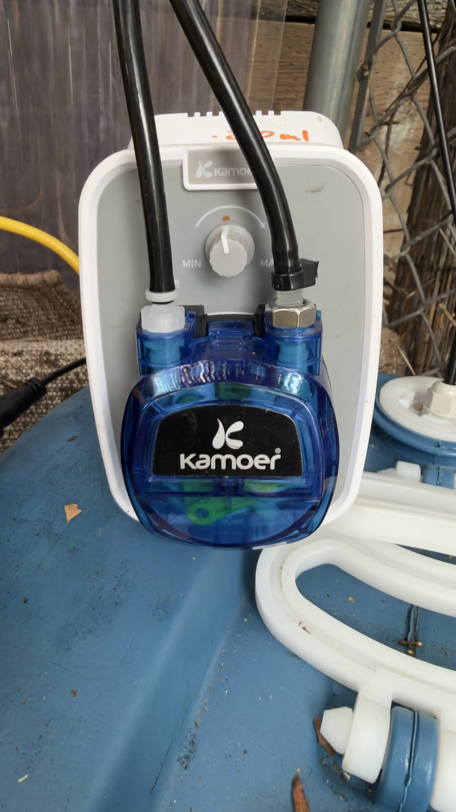
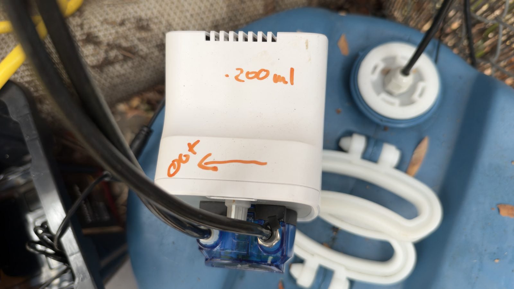
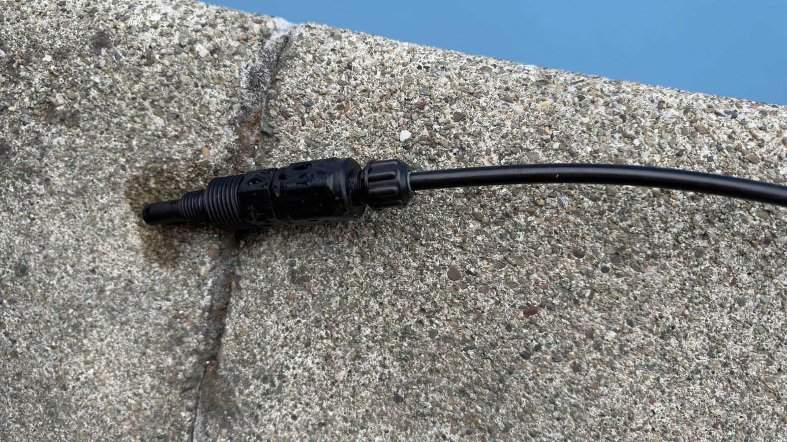
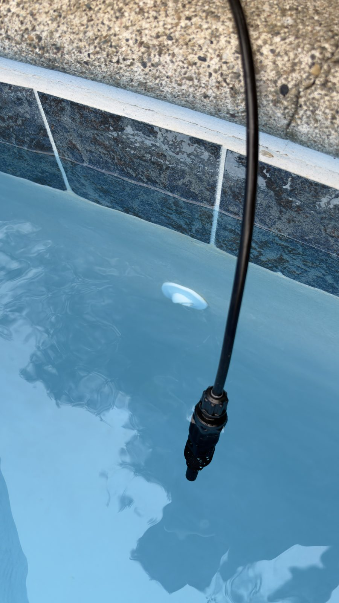
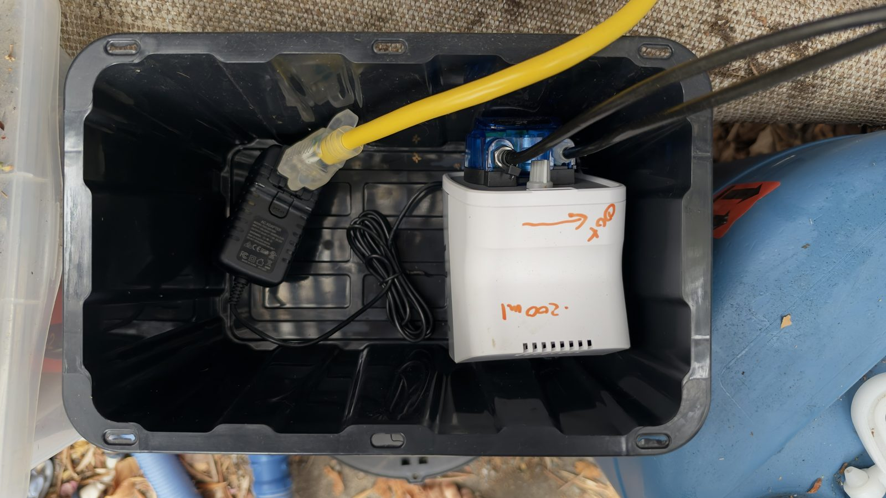

# Hardware guide: pool chlorine dosing with Hubitat, WaterGuru and a Z-Wave plug

Build a liquid chlorine dosing system around a **Kamoer KCPA600 peristaltic pump**, a **Zooz ZEN05
800LR outdoor Z-Wave plug** and **WaterGuru Dosing Advisor for Hubitat**. WaterGuru supplies periodic
chemistry measurements. The advisor calculates a bounded dose, and the Z-Wave plug switches the
pump's 24 V power supply.

**The pump needs no Wi-Fi connection.** Its speed is set locally with the knob, and Hubitat controls
the run time through Z-Wave. The WaterGuru integration has its own network and cloud requirements, so
taking the pump off Wi-Fi does not make the measurement side offline.

This guide documents my finished build. The photos show how the tubing is routed and how
the caps and pump are arranged. They cannot certify material compatibility, an enclosure rating or a
protective function. Those need the component specifications and your own commissioning tests.

Read the [Safety](../README.md#safety) section before you start. The software side (install,
settings, dosing model, faults) is in the [software guide](software.md). This guide was written
against WaterGuru Dosing Advisor 2.5.0, with the SLAM default and the over-limit cap updated for
2.5.1.

## Contents

- [Build at a glance](#build-at-a-glance)
- [Bill of materials](#bill-of-materials)
- [Chemical storage and PPE](#chemical-storage-and-ppe)
- [Assembly](#assembly)
- [Assembly photo gallery](assembly-photos.md)
- [Diagram gallery and editable sources](diagrams.md)
- [Calibration](#calibration)
- [Hubitat setup](#hubitat-setup)
- [Commissioning and operation](#commissioning-and-operation)
- [Maintenance and troubleshooting](#maintenance-and-troubleshooting)
- [Sources](#sources)

## Build at a glance

| Component or setting | This build |
|---|---|
| Pool volume | Nominal 25,000 US gallons |
| Chemical | Liquid sodium hypochlorite, configured as 12.5% |
| Reservoir | Nominal 15 US gallons. Record the actual usable fill separately |
| Pump | Kamoer KCPA600-N40, 24 V DC, speed set with a local knob |
| Pump-head tube | **Norprene, 4 mm ID × 7.2 mm OD**, the manufacturer's N40 configuration |
| External tubing | Black nominal 1/4-inch OD LLDPE |
| Pump delivery rate | **200 mL/min**, measured by weighing on 2026-10-19. Calibrate your own installation |
| Power switching | Zooz ZEN05 800LR, controlled by Hubitat over Z-Wave |
| Discharge | Tube-mounted check valve submerged near a pool return. No return pipe is tapped |
| Measurement | WaterGuru: scheduled samples, not continuous FC monitoring |
| Software | WaterGuru Integration, WaterGuru Dosing Advisor and the optional dosing tile |

Norprene is the correct tube name. It is not neoprene. Match replacement tubing to the exact pump
head, and confirm service life and chemical compatibility with the manufacturer. The product name
alone does not make it suitable for every chlorine concentration or pressure. [1]

### Physical dosing diagram


*Figure 1. The valve discharges into the pool beside the return fitting. The pickup inside the drum
is schematic. The figure does not give tank or pool elevations, component dimensions or installed
safety provisions. [PNG version](diagrams/01-system-layout.png).*

### Control and power diagram


*Figure 3. Data, commands and power take separate paths. The three runtime limits are this build's
settings, not three independent hardware disconnects. [PNG version](diagrams/03-power-and-control.png).*

The diagram shows functional connections, not mains terminals. The ZEN05's local auto-off timer is
separate from Hubitat's software timers. All of these controls still depend on the same outlet relay
opening, so they do not protect against every hardware failure.

## Bill of materials

**Affiliate disclosure: As an Amazon Associate I earn from qualifying purchases.** The Amazon links in
this BOM are affiliate links. I may receive a commission from qualifying purchases made through them.

Quantities refer to this build or the listing's pack size. They do not confirm how many items I bought.

| Item | Product and role | Quantity and fit note | Affiliate link |
|---|---|---|---|
| 1 | PEUTIER 5/32-inch thru-bulk plastic hose-barb fittings | Listing: 10 sets. Alternative fitting and vent hardware from the build experiments, not a pass-through for 1/4-inch OD tube. Verify resin, gasket and intended service. | [Amazon: B0CG598P44](https://www.amazon.com/dp/B0CG598P44?tag=hcdp-20) |
| 2 | EISCO 150 mm polypropylene powder funnel | One funnel used only for chlorine. Verify fit and chemical suitability. | [Amazon: B017UYYMKM](https://www.amazon.com/dp/B017UYYMKM?tag=hcdp-20) |
| 3 | Metpure black 1/4-inch OD LLDPE tubing, 25 ft listing | Length depends on the route. Verify tube markings, ID, pressure and chemical rating. | [Amazon: B08FCQD7RB](https://www.amazon.com/dp/B08FCQD7RB?tag=hcdp-20) |
| 4 | Zooz ZEN05 800LR outdoor single Z-Wave plug | One. Select the correct electrical supply and Z-Wave region. | [Amazon: B0BHF6MPNK](https://www.amazon.com/dp/B0BHF6MPNK?tag=hcdp-20) |
| 5 | superbobi 1/4-inch UCDBINJ-style injection check valve, replacement for Stenner pumps | One at the pool outlet, the listing holds two. An aftermarket replacement, not genuine Stenner. Confirm the tubing connection, thread, cracking pressure and pressure rating. | [Amazon: B0GKFVBMCX](https://www.amazon.com/dp/B0GKFVBMCX?tag=hcdp-20) |
| 6 | Kamoer KCPA600 adjustable-speed peristaltic pump | One, 24 V DC, Norprene N40 configuration. Confirm the power adapter is in the package you select. | [Amazon: B0B9XCPSSS](https://www.amazon.com/dp/B0B9XCPSSS?tag=hcdp-20) |
| 7 | Stenner ST114 1/4-inch suction strainer | One pickup strainer. It is a strainer, not a foot valve or check valve. | [Amazon: B00HEASYCA](https://www.amazon.com/dp/B00HEASYCA?tag=hcdp-20) |
| 8 | TR Industrial black UV-resistant 8-inch cable ties | Listing: 100-pack. For support only, not a substitute for pressure-rated hose clamps. | [Amazon: B01018DC96](https://www.amazon.com/dp/B01018DC96?tag=hcdp-20) |
| 9 | XHF nylon NPT cable-gland assortment | Listing: 48 pieces. Select by tube OD and mounting specification. An electrical gland is not automatically an approved chlorine-tank fitting. | [Amazon: B07FPCH344](https://www.amazon.com/dp/B07FPCH344?tag=hcdp-20) |
| 10 | 3M multipurpose reusable respirator, medium listing | Fit and cartridge choice are individual. Verify the cartridge numbers included and the approved assembly. See PPE below. | [Amazon: B002MB4MUY](https://www.amazon.com/dp/B002MB4MUY?tag=hcdp-20) |

A listing title is not a material-compatibility certificate. Check each part against its maker's
specification before it touches chlorine.

### Additional parts and prerequisites

The ten links are not a complete kit. You also need:

- A Hubitat hub and a WaterGuru sensor with its consumables and connectivity.
- A reservoir approved for the chemical, its correct bung seals and the venting its maker approves,
  plus dedicated secondary containment.
- A matched 24 V power adapter if the pump package does not include one.
- Adapters between the pump's 4 mm ID tube and the external 1/4-inch OD tube. Record both sides'
  dimensions and materials.
- A secure mount for the pool-side tube and check valve, with backflow and anti-siphon measures
  matched to your actual reservoir and pool elevations.
- Outdoor mounting or an enclosure, strain relief, tubing supports and a protected electrical
  supply. Keep electrical equipment away from the reservoir vent and from possible leaks.
- An independent no-flow or low-flow feed interruption suited to the installation. The app's
  "circulation runs continuously" checkbox is not a flow sensor.
- Dedicated measuring equipment, an independent pool test kit, chemical-resistant gloves, splash eye
  and face protection, and the PPE the chemical's SDS specifies.

The ZEN05 provides the local maximum-runtime timer described below. Confirm it works on your device.
An app setting does not set the plug's local timer.

### Buying the whole BOM

Use the individual links. Amazon Business offers a
[Shared Cart](https://business.amazon.com/en/solutions/streamlined-purchasing/shared-cart) for
organizational purchasing, but there is no public one-click cart for this BOM.

## Chemical storage and PPE

### Storage and reservoir safety

Keep incompatible chemicals apart. Whatever distance you choose must also stop their spills from
reaching each other, because distance alone does not prevent mixing. Follow each product's label and
SDS and the storage rules that apply where you live.

Give each chemical its own place. Keep liquid chlorine away from acids, stabilized chlorine tablets
and other incompatible products, with separate containment and no shared spill route. Store liquid
containers low, well supported, shaded and away from heat. Keep rain and dirt out of dry chemicals.
Keep chemicals in their original labeled packaging and do not routinely move cal-hypo into an
ordinary bucket. Follow the maker's instructions if packaging is damaged. [5, 6]

For the dosing reservoir, check that the container, fittings and venting are approved for the
chemical. Do not seal up a reservoir that needs venting. Secure it against tipping and keep children
and animals away from it.

#### Never mix these chemicals

| Combination | Hazard and prevention |
|---|---|
| Liquid chlorine + muriatic acid or sodium bisulfate ("pH Down") | Can release highly toxic chlorine gas. Keep storage, containment and handling tools separate. |
| Liquid chlorine + trichlor or dichlor | Can react violently and release toxic gas. Never mix different chlorine products. |
| Calcium hypochlorite + trichlor or dichlor | Can cause fire or explosion. Never share containers, scoops or feeders. |
| Calcium hypochlorite + organic contamination or improper wetting | Heat, toxic gases and fire can result. Keep dirt, leaves, oils and contaminated tools away, and keep water out of stored product. |

These warnings concern concentrated products and accidental mixing. Follow the product labels for
pool treatment. Cal-hypo is a reactive oxidizer: keep it away from other chlorine products and from
contamination. [6, 7]

If chemicals mix, get hot or give off fumes, leave the area, keep others away and call emergency
services from a safe place. Do not go back to investigate or try to neutralize an unknown mixture.

### Respirator and other PPE

**An air-purifying cartridge respirator is not equipment for responding to an accidental chlorine
release.** It is unsuitable for unknown concentrations, low oxygen or immediately dangerous
conditions, and a full facepiece does not remove these limits. [8]

Protection depends on the cartridge, a compatible facepiece, fit, service life and the exposure
conditions.

#### Cartridges

- N95 and P100 particulate filters alone do not remove chlorine or hydrogen chloride gas.
- Select a NIOSH-approved cartridge and facepiece combination whose approval and instructions cover
  the specific gases, including chlorine and hydrogen chloride where they are present.
- Gas and vapor cartridges usually use treated sorbents such as activated carbon. A generic carbon
  mask or nuisance-odor filter is not the same as an approved gas cartridge.
- Add approved particulate filtration when you also need protection from mist.
- Label color only helps identify a cartridge. Common 3M codes are white for acid gas, yellow for
  organic vapor and acid gas, and olive for multi-gas and vapor. Verify the exact approved chemicals
  and configuration. A cartridge does not need a literal "HCl" or "Cl₂" stamp.
- Check which cartridges actually come with BOM item 10. The product title does not tell you. [8, 9]

#### Facepiece and fit

Use a compatible reusable elastomeric half or full facepiece in a size that passes a fit test.
Silicone, rubber or thermoplastic elastomer can all work, but the material alone proves nothing.

Do the maker's user seal check every time you put the respirator on. A seal check does not replace
a fit test. Facial hair or anything else at the sealing surface prevents a dependable fit. [10]

A half facepiece leaves the eyes exposed. Wear chemical splash goggles chosen for the SDS and
compatible with the respirator. Splash goggles, even unvented ones, do not protect against hazardous
gas concentrations. A full facepiece covers the eyes only within its approved conditions of use.

#### Cartridge service life

Set a change schedule the maker supports for the chemical and the conditions of use. Do not wait for
a smell to tell you to replace a cartridge. Leave at once if you notice irritation, a smell or a
suspected leak. Record when cartridges are opened and replaced, and follow the storage instructions.
[11]

Respirators do not replace ventilation, spill prevention, suitable gloves or eye and face
protection.

## Assembly

### 1. Lay out the reservoir and components

Keep the reservoir secure, shaded and in dedicated containment. Plan the filling access so you never
reach over live electrical equipment. Use closures and venting the maker approves, and do not make
the reservoir airtight if the container or chemical needs venting.



*The finished reservoir and the covered equipment beside it (IMG_0546). No containment tray is
visible in this frame. Provide the containment described under storage.*

### 2. Fit the suction pickup

The tubing runs unbroken from the pump through a cap fitting down to the suction strainer. Position
the pickup as the equipment instructions require, and protect the tube from kinks and abrasion.


*Figure 2. The cap roles match this build. The internal geometry and the gland section are
explanatory. Use the actual component specifications for mounting holes, seals, venting and pickup
placement. [PNG version](diagrams/02-reservoir-cutaway.png).*



*The tube pass-through before it goes into the cap: the black tube runs unbroken through the white
cable gland.*

Do not confuse two kinds of connection:

| Connection | How it works | Dimension that matters |
|---|---|---|
| Hose barb | The tube fits **over** the barb and liquid flows inside the fitting. | The tube's **inside diameter** and the specified barb and clamp combination. |
| Tube pass-through | An unbroken tube passes through the cap fitting and liquid stays inside the tube. | The tube's **outside diameter**, the fitting's grip range, the seal and the cap-mounting specification. |

A 5/32-inch barb listing does not mean the barb has a bore a 1/4-inch OD tube can pass through.
Likewise, "1/4 NPT" is a nominal pipe-thread size, not a 1/4-inch hole or a guaranteed grip range.



*The installed pickup cap (IMG_0547). The black tube passes through the white gland. The seal
materials and the pickup inside the drum are not visible.*

For any tank penetration, make sure the body and seal materials are approved for the chemical. An
IP68 ingress rating does not certify compatibility with concentrated sodium hypochlorite or its
vapor. The XHF glands in the BOM are what this build used, not a certified tank fitting.

Follow the fitting maker's mounting-hole specification and gasket arrangement. Take the cap off the
drum to work on it, keep swarf out of the tank and inspect the finished seal. An oversized hole with
a fender washer is not a validated seal, and masking tape is not a chemical seal.

### 3. Provide filling access and venting

One bung cap carries the suction tube. The other is the fill and vent cap, with a small open hole
(IMG_0545). Identify each cap by its actual thread and gasket: the photos do not establish a
universal left or right, or fine or coarse thread, assignment.



*The fill and vent cap (IMG_0545), with the hole this build uses. The photo does not give the hole's
diameter, vent capacity or any chemical approval.*

Use a closure and vent specified for the tank and the chemical. Keep the vent clear and pointed away
from people and electrical equipment. A small drilled hole is not a universal vent design. Disable
dosing and isolate pump power before you refill or touch the pickup. Afterwards put the proper
closure back and check for leaks.

### 4. Mount and connect the Kamoer pump

Mount the pump in a protected location. Connect the suction and discharge sides in the direction the
pump marks. Use the correct Norprene pump-head assembly and suitable transitions to the 1/4-inch OD
LLDPE line. Do not pick a reducer size from the outside diameter alone.

Set the speed knob, record its position and leave it there after calibration. Moving the knob
changes the delivery rate and makes the Hubitat runtime calculation wrong. Recalibrate after you
change the tube, the plumbing, the speed or the discharge.

The maker's reference configuration uses a 24 V, 1 A adapter and quotes 180 to 520 mL/min. Those
figures do not replace a measurement on the installed system. [1]



*The pump's connections (IMG_0549). The right-hand adapter has a metal-looking hex nut. It may be
outside retaining hardware. Identify the fitting and its wetted parts before you call the path
all-plastic. The cable tie in the photo is support, not a pressure seal.*



*Owner markings (IMG_0550). OUT marks the outlet. Verify the actual flow direction during safe
commissioning. The handwritten "200 ml" is this pump's measured rate per minute at its knob setting
(see [Calibration](#calibration)).*

### 5. Connect the discharge

The check valve sits at the end of the black discharge tube, submerged in the pool near a wall
return fitting. This build discharges straight into the pool. It does not connect to the pressurized
return pipe.



*The valve and its tube connection (IMG_0543). The threaded valve body is exposed. Liquid enters
from the tubing side and leaves through the nozzle, in the direction the valve marks.*



*The pool outlet (IMG_0544). The valve hangs in the pool near the return and is not attached to it.
No permanent outlet support is visible.*

The [physical dosing diagram](#physical-dosing-diagram) shows this direct discharge. Follow the
valve's own flow marking: the drawing does not specify its internals or a mounting orientation.

Use the valve's specified tubing connection and retention parts. Then check that the pump opens the
valve and delivers the calibrated volume at the actual outlet depth. Direct discharge takes the
return pipe's pressure out of the picture, but the valve's opening pressure, losses in the tube and
the immersion depth still matter.

Secure the tube and valve against movement, abrasion and swimmers. Check backflow and siphon
protection for your actual tank and pool levels. The submerged outlet has no air gap, and a check
valve alone does not prove protection against forward siphoning. Provide the physical no-flow or
low-flow feed interruption listed in the prerequisites. [5]

### 6. Connect power

Plug the pump's matched 24 V adapter into the ZEN05 and connect the adapter's DC output to the pump.
Follow all equipment instructions for outdoor use, GFCI protection, mounting and weather. Keep
connections away from spills and chemical vapor. A cable gland does not by itself make the pump or
its enclosure fit for outdoor use.

The pump needs no network setup. Include and configure the ZEN05 in Hubitat as described below. Keep
the pump's power physically isolated during setup so a test command cannot dose chlorine.



*The open equipment cover (IMG_0551). The pump and adapter sit inside a black storage tote. The
gallery shows the yellow lid closed (IMG_0548). The ZEN05 is not visible. The photo does not show a
weatherproof enclosure rating, sealed cable entries, strain relief or upstream GFCI protection.
Specify those rather than treating a closed lid as proof of them.*

## Calibration

Follow the pump maker's commissioning and calibration method with automation disabled. Record the
liquid, knob position, tubing, suction lift, outlet conditions, time and collected volume. A test
with water and an open outlet is a useful record, but it may not match chlorine delivered against a
different backpressure. Never disconnect a pressurized chemical line to measure it.

```text
flow_mL_per_min = collected_mL / elapsed_minutes
runtime_seconds = ceil(required_mL / flow_mL_per_min * 60)
```

This build measured **200 mL/min** on 2026-10-19 by weighing one real run: 2,293 g of 12.5% chlorine
(specific gravity about 1.19) is about 1,930 mL in 580 s. Grams are not millilitres, so divide the
weight by the specific gravity. [Calibrate the pump rate](../README.md#calibrate-the-pump-rate) in
the main README describes the method. Whenever you recalibrate, update the Hubitat setting and the
label on the housing together.

| Example dose | Runtime at 200 mL/min, rounded up |
|---|---|
| 237 mL | 72 seconds |
| 1,000 mL | 300 seconds, 5 min |
| 3,000 mL | 900 seconds, 15 min |

WaterGuru Dosing Advisor calculates the dose as:

```text
dose_fl_oz = FC_deficit_ppm * (pool_US_gallons / 10000) * 10.7 * (12.5 / product_percent)
dose_mL = dose_fl_oz * 29.5735
```

For a 25,000 gallon pool and 12.5% chlorine, a 0.3 ppm deficit gives about **237.3 mL**, or **72
seconds** at 200 mL/min. This is the software's approximation, not proof of the FC rise you will
get. Verify the pool volume, the product's concentration basis and its current strength, then check
the result with an independent test. Sodium hypochlorite by weight percent and available chlorine
are not interchangeable without the right conversion. [3]

## Hubitat setup

### 1. Install the software

| Component | Purpose and source |
|---|---|
| WaterGuru Integration | Creates the pool device and imports the chemistry readings. A separate package by Brian Wilson, see [its installation instructions](https://github.com/bdwilson/hubitat/tree/master/WaterGuru). |
| WaterGuru Dosing Advisor | Parent and pool child apps that calculate and control dosing. |
| WaterGuru Dosing Tile | Optional dashboard driver, part of the advisor package. |
| Pump Power Profiler | Optional app that records each run's power to a CSV file and watches for pump wear. |
| Zooz plug driver | This build uses **Zooz ZEN Plugs Advanced** by jtp10181, installed through Hubitat Package Manager. Check that it supports your ZEN05 800LR and sends fresh switch and power reports. |

The [software guide](software.md) has the install steps (Hubitat Package Manager or manual) and
every setting. Then open **Apps > Add User App > WaterGuru Dosing Advisor** and add a pool. Select the
WaterGuru device, the dedicated ZEN05 pump plug and a notification device.

### 2. Configure the ZEN05

Include the plug following the maker's Hubitat instructions, select the driver and configure it.
With the pump isolated, check ON and OFF, fresh power reports and what the plug does when power
returns.

| ZEN05 parameter | This build | Purpose |
|---|---|---|
| 2: Auto turn-off timer | **19 minutes** | Local plug backstop, independent of Hubitat's scheduling. |
| 4: Auto turn-on timer | **0, disabled** | No recurring ON timer on the plug. |
| 6: State after power failure | **Forced off** | The pump does not restart when power returns. |
| 8: Physical button | **Disabled** | No accidental starts from the button. Provide an accessible physical power disconnect instead. |
| 9: Power report threshold | **5 W** | A start and a stop each change the power by more than this, so each sends a report. |
| 10: Power reporting frequency | **700 minutes** | Timed power reports are effectively off. During a run the app asks the plug for a report every 10 seconds instead (see below). |
| 13: Power reports | **Enabled** | Lets the app confirm a start from the pump's power. |

Zooz documents these parameters. Read the settings back from the device and test the local auto-off
safely: driver labels and available settings vary by firmware. [2]

A periodic power report every few minutes cannot by itself satisfy the app's 30 second running-power
check. Check that the driver answers a refresh and sends a report even when the wattage has not
changed. The advisor relies on those reports. A cached power value is not enough. [3]

### 3. Configure the pool advisor

Start in **ADVISORY** mode. Enter the measured pump rate, the pool volume, the product strength and
the actual reservoir contents. For routine dosing, check that **SLAM mode is off**: it is off by default
since 2.5.1, but an install that saved it on keeps it, and a routine setup should not inherit a
recovery-treatment target.

| Setting | This build, or the action to take |
|---|---|
| Pump rate | 200 mL/min in this build. Use your own calibration |
| Pool volume and product strength | 25,000 US gal and 12.5% in this build. Check against your pool and label |
| Reservoir | 15 US gal nominal, about 56,781 mL. Start from the actual fill, not an assumed full drum |
| FC target | 6.0 ppm in this build. Choose one that suits your CYA and treatment guidance |
| Maximum sample age | 18 hours |
| Minimum and maximum single dose | 50 and 3,000 mL |
| Maximum daily dose | 3,500 mL |
| One AUTO dose per calendar day | Enabled |
| AUTO window | 19:30 to 23:00 in this build. Check that the hub has the right local time zone |
| Maximum planned runtime | **17 minutes** in this build (the app ships with 14) |
| App emergency cutoff | **18 minutes** in this build (ships with 15). It must be later than the maximum planned runtime |
| ZEN05 local cutoff | **19 minutes**, set separately on the plug |
| Minimum running power | 3 W by default. Check it against the pump's measured power |
| Start-evidence timeout | 20 seconds by default |
| Running-power loss grace | 30 seconds by default |
| pH guard | 6.8 to 8.2. These are automation bounds, not a recommended swimming range |
| Low-tank alert | For example 20% of the usable starting volume |

The runtime limits must rise in this order: **planned maximum < app emergency cutoff < plug local
cutoff**. At 200 mL/min a 3,000 mL dose needs 15 minutes. With the shipped 14 minute maximum that
dose is shortened to the 2,800 mL that 14 minutes covers: since 2.5.1 the app caps an over-limit
dose to the limits (a 0.0 reading or a drop over 4 ppm still blocks it whole), where up to 2.5.0 it
refused such a dose whole outside SLAM mode. That is why this build runs 17, 18 and 19 minutes, which fits
the 3,000 mL maximum with 2 minutes to spare. If your pump is slower, work out the effect rather than
loosening every limit.

The 19 minute plug limit is a last runtime backstop, not a daily volume limit. At 200 mL/min it could
let about 3,800 mL through during a fault, more than the 3,500 mL daily cap. Choose all limits for
your own pool and risk, and verify them during commissioning.

### 4. Configure measurement timing and circulation

WaterGuru measures on a schedule. The measurement, the integration's cloud polling and the advisor's
refresh are separate events. The advisor's **Daily WaterGuru fetch time** defaults to 19:45. Set it
about 30 minutes after the measurement time configured in the WaterGuru app, because the pod needs
12 to 15 minutes to read. The app page shows the time of day WaterGuru has actually been measuring
at, so check it against your setting. If the daily fetch brings no new sample, the advisor fetches
once more 45 minutes later (20:30 for 19:45), inside the AUTO window only. [3, 4]

Use a real circulation interlock where you can. The software also offers a confirmation that
circulation runs continuously. That records your assertion. Neither it nor a circulation switch's ON
report proves that water is flowing. The photos of this build do not show a physical flow cutoff.
Record its installation and test result separately from the checkbox.

After installing or updating the code, open the pool child app and press **Done** while the pump is
idle. The app refuses to start a dose until its subscriptions have been refreshed this way. Saving
can send OFF to the plug, so never update during a dose. [3]

### 5. Understand the dosing sequence


*Figure 4. One dosing attempt with a ZEN05 that reports power. Failed starts and stop recovery are
shown apart from the normal run. [PNG version](diagrams/04-dosing-sequence.png).*

This is an overview of the published controller, not a replacement for it. The controller tells an
ON request apart from evidence that the pump draws power. Power still does not measure chemical
flow, so the dose volume and the tank level stay estimates from the calibrated rate and the observed
run time.

Use **APPROVAL** for supervised dosing once commissioning is done. Enable **AUTO** only after you
have validated the installation and its failure behavior. Advisory calculations, previews and
scheduled summaries never start the pump. Do not run a Rule Machine timer or any other dosing
automation against the same outlet without a deliberate plan for how they coordinate. [3]

### 6. Dashboard and optional history

Add the dosing tile device to a Hubitat dashboard with the **Attribute** template and the
`recommendation`, `tileHtml` or `status` attribute. The [Dashboard tile](software.md#dashboard-tile)
section of the software guide lists every attribute. Notifications can report the calculated dose,
the confirmed run, faults and the tank estimate.

I also keep a history in InfluxDB and Grafana, but dosing works without it. My collector and
dashboards are public as [waterguru-grafana](https://github.com/chsbusch-dot/waterguru-grafana). If you build your own,
read the advisor's published attribute names (for example `lastDoseMl`, `lastDoseEpochMs`,
`lastDoseRuntimeSeconds`, `tankRemainingMl`, `tankCapacityMl`, `freeChlorine` and
`targetFreeChlorine`). Do not add up repeated readings as separate doses, because a correction can
reuse the same dose timestamp. [3]

## Commissioning and operation

### Before introducing chlorine

Use a safe test setup the maker approves, with the chemical source isolated. Confirm:

- No leaks, the right pump direction, secure tubing and working backflow and siphon protection.
- A repeatable calibration under representative outlet conditions.
- A normal start with power evidence, a planned stop and a fresh OFF report.
- The plug's local auto-off with Hubitat unavailable, and OFF after a power cycle.
- The feed stops when circulation is lost, including through the physical interlock.
- Stale or duplicate samples, missing power reports, an excess dose or runtime and low inventory
  prevent or stop dosing as documented.
- A failed or uncertain attempt cannot quietly lead to a second automatic dose.
- A hub restart, a code update, a manual disable and the emergency disconnect behave as expected.

Do not create a hazardous chemical condition to test a guard. Use isolated hardware or controlled
inputs, with the pump disconnected from the chemical supply. Record the app version, plug firmware,
driver, settings and the outcome of each test.

### Normal operation and refilling

Check the independent water test, the sample timestamp, the reservoir and the tubing regularly. Let
the current chemistry and the product instructions decide the treatment rather than copying the
example 6.0 ppm target.

Before refilling, disable dosing and isolate the power. Use clean handling tools kept for chlorine
and the PPE the SDS specifies. Put the approved closure and vent back and check for leaks. Record how
much you actually added. Use **Mark chlorine tank full** only when the configured usable volume is
really there, and the inventory adjustment for a partial refill. The estimate cannot detect a leak or
an empty pickup.

If a dose is uncertain, investigate and test the water before you correct the inventory or dose
again. Do not acknowledge a pump fault just to force another attempt. Never add acid or tablet
chlorine to this reservoir or dosing line.

## Maintenance and troubleshooting

Inspect the Norprene tube, connections, reservoir, vent, strainer and outlet for wear, restriction
and leaks. Follow the component makers' replacement intervals and recalibrate after service. This
guide does not claim a fixed tubing life.

| Symptom | Check |
|---|---|
| Plug ON requested, pump does not run | Fresh switch and power reports, the plug connection, the DC adapter and the pump knob. Read the start fault's reason. |
| Pump runs but delivers little liquid | Actual volume, an air leak on the suction side, the pickup level, a worn tube, a kink or a restricted outlet. Wattage alone cannot show flow. |
| A healthy run trips a power-evidence fault | The driver's refresh behavior, unchanged reports, Z-Wave communication and the measured power threshold. |
| No AUTO dose after an update | Open the pool child app and press Done while idle. Check the mode, the subscriptions and the guard's reason. |
| Dose is blocked | Sample age, a sample or day already used, the window, circulation, pH, a runtime or volume limit, or inventory. |
| Tank estimate drifts | The refill record, the calibration, partial or uncertain runs and any manual pump use. Reconcile against what is physically in the drum. |
| Liquid moves while power is off | Isolate safely and investigate siphon and backflow protection. Do not rely on another software OFF. |

Photos of the finished build are in the [assembly photo gallery](assembly-photos.md). The four
editable diagrams, their PNG exports and the script that draws them are in the
[diagram gallery](diagrams.md).

## Sources

1. [Kamoer KCPA600 technical specifications](https://www.kamoer.com/us/product/params.html?id=10005) and [product overview](https://www.kamoer.com/us/product/detail.html?id=10005).
2. [Zooz ZEN05 advanced settings](https://www.support.getzooz.com/kb/article/1118-zen05-outdoor-plug-advanced-settings/).
3. [WaterGuru Dosing Advisor software guide](software.md).
4. [WaterGuru measurement workflow](https://support.waterguru.com/hc/en-us/articles/1260804808989-How-do-I-perform-a-Water-Measurement-of-my-pool-water).
5. [CDC: Pool Chemical Safety](https://www.cdc.gov/healthy-swimming/toolkit/pool-chemical-safety.html).
6. [EPA: Safe Storage and Handling of Swimming Pool Chemicals](https://nepis.epa.gov/Exe/ZyPURL.cgi?Dockey=P1002ZKY.TXT).
7. [EPA: Swimming Pool Chemicals advisory](https://www.epa.gov/sites/production/files/2013-11/documents/chlor.pdf).
8. [3M Organic Vapor/Acid Gas Cartridge 6003: approved hazards and limitations](https://www.3m.com/3M/en_US/p/dc/v000093369/).
9. [3M Cartridge and Filter Guide](https://multimedia.3m.com/mws/media/565214O/cartridge-and-filter-guide-brochure-70-0714-8870-7.pdf).
10. [NIOSH: User Seal Check](https://stacks.cdc.gov/view/cdc/53108).
11. [3M Cartridge Change FAQs](https://multimedia.3m.com/mws/media/259820O/3m-cartridge-change.pdf).

The build values come from my installation: photos taken in October 2026 and the pump
weighed on 2026-10-19.
