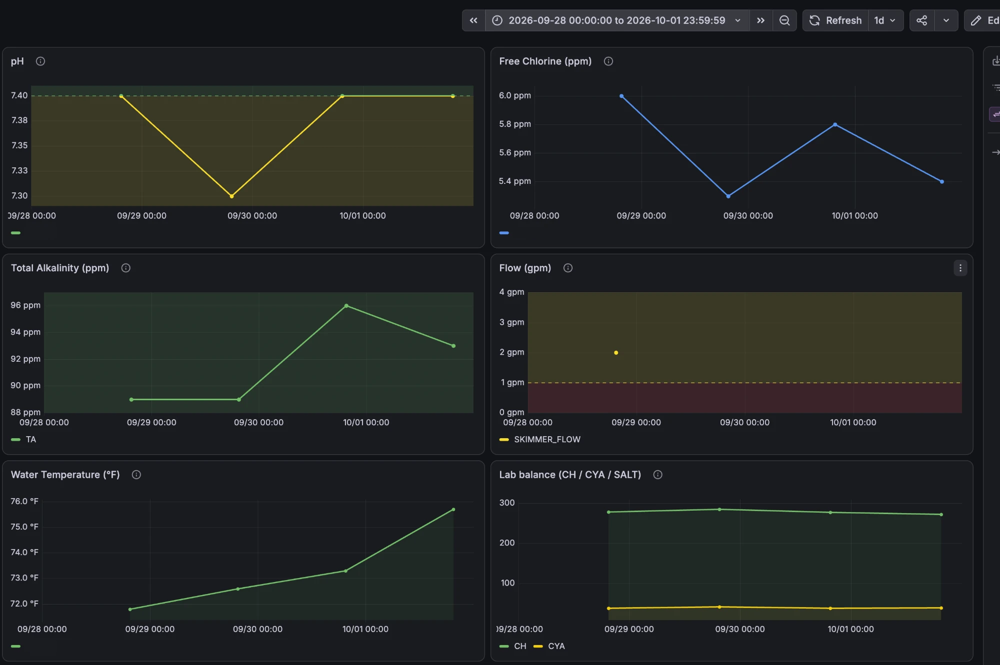
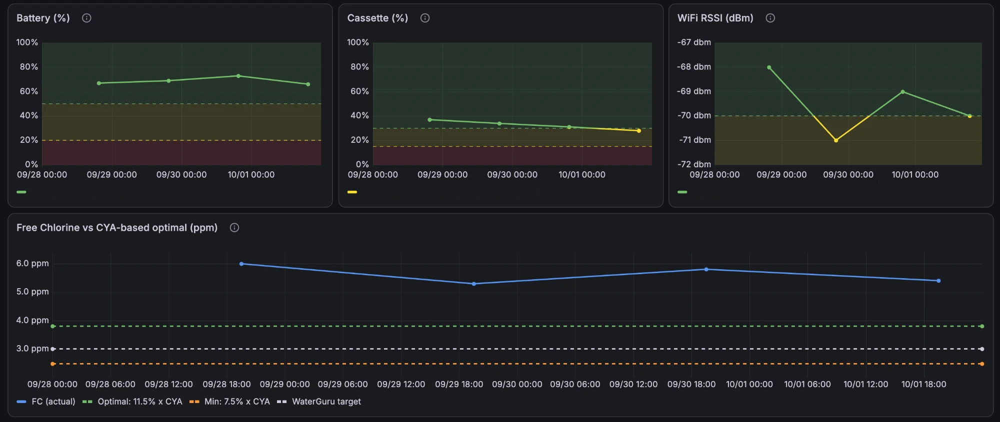
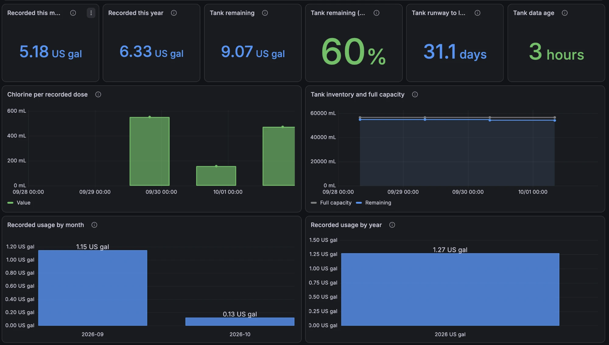
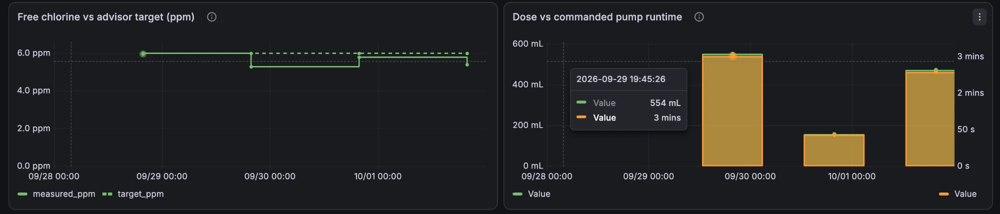

# WaterGuru → Grafana

A daily collector that pulls everything the (unofficial) WaterGuru cloud API reports for a pool
SmartPod and writes it to InfluxDB 2 at each reading's real timestamp, plus a Grafana
dashboard that charts pH, free chlorine, temperature, flow, battery, RSSI and the lab-cassette
values over time.

The SmartPod measures about three times a day. A once-daily poll would miss most of that if it
only read the "now" value, so the collector pulls the API's **measurement history** since the
last run and backfills every reading at its true timestamp, so the data keeps its full
resolution.

Optionally, the same run reads liquid chlorine doses and tank inventory from a Hubitat hub that
runs the [WaterGuru Dosing Advisor](https://github.com/chsbusch-dot/hubitat-waterguru-dosing-advisor)
app, for the dashboard's chlorine usage and tank panels.

## Architecture

```
scheduler (cron, a NAS task scheduler, a systemd timer), once a day
      │  docker compose run --rm waterguru-poll   (one-shot container)
      ▼
waterguru-poll ── AWS Cognito SRP auth ──▶ WaterGuru cloud (Lambda invocations)
      │                                     • prod-getDashboardView  (snapshot + lab values)
      │                                     • prod-managePod          (reading history)
      │
      ├── optional, read only ──▶ Hubitat hub, MCP Rule Server (chlorine doses + tank)
      │
      │  InfluxDB 2 line protocol (docker network)
      ▼
InfluxDB 2 (default bucket: waterguru)  ◀── Grafana (dashboard: WaterGuru Pool)
```

The collector joins the docker network of an existing InfluxDB 2 container and writes to
`http://influxdb:8086` over it, so InfluxDB does not have to be exposed on the LAN. The collector
publishes no host port.

## InfluxDB schema

Defaults: org `home`, bucket `waterguru` (both configurable). Three measurements come from the
WaterGuru cloud:

| Measurement | Source | Tags | Key fields |
|---|---|---|---|
| `waterguru_pod` | `prod-managePod` history | `pod_id`, `water_body_id` | `ph`, `freeCl`, `waterTempFahr`, `flowTempDeltaFahr` (raw flow signal), `battVolts`, `battLoadedVolts`, `intResist`, `rssi`, `padReadCnt`, plus flattened `*Rgb_0/1/2` and `*Orient_0/1/2` arrays. One point per real reading. |
| `waterguru_measure` | `prod-getDashboardView` | `water_body_id`, `type` | `value`, `target`, `status`, `status_code` (0/1/2 = GREEN/YELLOW/RED), `first_alert`. Types: `FREE_CL`, `PH`, `SKIMMER_FLOW`, `TA`, `CH`, `CYA`, `SALT`, `PHOSPHATES`, `COPPER`, `IRON`, `SATURATION_INDEX`, `TH`. Includes the lab-cassette values that never appear in the pod history. |
| `waterguru_status` | `prod-getDashboardView` | `water_body_id` | `water_temp`, `overall_status`, `overall_status_code`, `battery_pct`, `cassette_pct`, `cassette_days_remaining`, `rssi`, `rssi_bars`, `free_cl_target`, `ph_target`, `flow_gpm_target`, `salt_target`. |

The optional Hubitat step adds `chlorine_dose`, `chlorine_tank` and the advisor's free chlorine
target; [`grafana/CHLORINE-CHARTS.md`](grafana/CHLORINE-CHARTS.md) has their field contract.

The pod mapping writes every numeric field the API returns (coerced to
float for one consistent type per key) rather than a hardcoded subset, so new firmware fields
appear in Grafana automatically.

**Idempotency:** InfluxDB deduplicates on measurement + tag set + timestamp. Every reading is
tagged by `pod_id`/`water_body_id` (or `type`) and written at its own timestamp, so re-running
over an overlapping window never creates duplicates. A per-pod watermark (`/state/watermark.json`)
bounds how far back each run queries. Losing it just triggers a larger, still idempotent backfill.

## Quick start

You need Docker with Compose v2, an InfluxDB 2 container on a docker network, a Grafana with an
InfluxDB datasource that uses **Flux**, and the login of your WaterGuru app account.

1. **Configure.** Copy the example environment and fill in the three secrets:

   ```bash
   cp .env.example .env
   chmod 600 .env
   ```

   `WATERGURU_EMAIL` and `WATERGURU_PASSWORD` are your WaterGuru app login. `INFLUX_TOKEN` is an
   InfluxDB token that can write the bucket (and create it, while `WG_ENSURE_BUCKET` is true).
   Set `HUBITAT_NETWORK` to the docker network your InfluxDB container is on
   (`docker network ls`), and `INFLUX_URL` if that container is not reachable as `influxdb`.
   The compose file treats the network as external, so it must already exist. If InfluxDB does
   not run in Docker, create a network for the collector (`docker network create waterguru`),
   set `HUBITAT_NETWORK=waterguru` and point `INFLUX_URL` at the InfluxDB host.

2. **Build** an immutable, versioned image tag, and put the same tag into `.env` as
   `WATERGURU_IMAGE_TAG` so scheduled runs use it:

   ```bash
   WATERGURU_IMAGE_TAG=0.1.0-$(git rev-parse --short HEAD) docker compose build
   ```

3. **Dry run.** This prints the line protocol and writes nothing:

   ```bash
   docker compose run --rm -e WG_DRY_RUN=true waterguru-poll
   ```

4. **First run.** The first run has no watermark and backfills `WG_BACKFILL_DAYS` (default 365):

   ```bash
   docker compose run --rm waterguru-poll
   ```

   The log ends with a `Done: ... written` line.

5. **Schedule** the same command once a day. With cron, for example:

   ```
   15 6 * * * cd /path/to/waterguru && docker compose run --rm waterguru-poll >> /path/to/waterguru-poll.log 2>&1
   ```

   On a NAS, a task scheduler (Synology DSM's Task Scheduler, for one) runs the same command as
   a user that may use Docker. After the first backfill each run is incremental: it queries from
   the watermark minus a 48 h overlap and writes only the new readings.

The exit code tells the scheduler how the run went: `0` all configured sources collected, `1` a
source failed or was degraded (the other source's data is still written), `2` a configuration
error. A scheduler that reports non-zero exits therefore reports partial runs too.

### Building and upgrading the image

Build **immutable versioned tags** and always keep the previous image. The tag is selected by
`WATERGURU_IMAGE_TAG` (default `latest` in `docker-compose.yml`). Pick a new one per build, for
example `0.1.0-<git-short-sha>`, because rebuilding the *same* tag can succeed having changed
nothing.

* **Never delete the current image before its replacement has built and passed a dry run.**
  A deleted image cannot be rolled back to.
* **Upgrade:** build a new tag, point `WATERGURU_IMAGE_TAG` at it, run the dry run, and let the
  next scheduled run pick it up.
* **Roll back:** point `WATERGURU_IMAGE_TAG` back at the previous tag.

The build is reproducible and auditable:

* The base image is pinned by an **immutable digest** in the `Dockerfile`
  (`python:3.12-slim@sha256:f77ac9e4…`, resolved from the moving tag on 2026-09-26). To move it,
  resolve the new digest and update that line plus this note.
* Runtime dependencies are installed from the committed, hash-checked `requirements.lock`
  (`pip install --require-hashes -r requirements.lock`). After changing dependencies in
  `pyproject.toml`, regenerate it (tested with uv 0.11.x):

  ```bash
  uv pip compile pyproject.toml --universal --python-version 3.12 --generate-hashes \
      --no-header -o requirements.lock.body   # then re-add requirements.lock's header lines
  ```

  Dev-only tools (pytest/ruff/mypy/pyyaml) are intentionally not in the lock. CI installs them
  from the `dev` extra.
* The application is not `pip install`ed inside the image (`src/` is on `PYTHONPATH`), so the
  image build performs no unpinned build-isolation downloads.

## Grafana dashboard

"WaterGuru Pool" has panels for pH, Free Chlorine, Total Alkalinity, Flow, Water Temperature, a
Lab balance panel (CH/CYA/SALT), Battery %, Cassette %, WiFi RSSI and Free Chlorine against the
CYA-based optimum, followed by the chlorine usage and tank panels. The chlorine panels need the
optional Hubitat dosing telemetry, which the WaterGuru cloud does not supply. See
[Chlorine chart data requirements](grafana/CHLORINE-CHARTS.md) for the field contract, Pacific
calendar totals, and standalone Flux queries.

### Screenshots

The four images show the one dashboard, "WaterGuru Pool", from top to bottom, for 28 September
to 1 October 2026. Pod and device IDs in the legends are blanked out.



Water chemistry: pH, free chlorine, total alkalinity, flow, water temperature and the lab
balance (calcium hardness and CYA, plus salt when the pod reports it). The shaded bands are
each panel's thresholds.



Pod health and stabilizer-aware chlorine: battery, cassette and WiFi signal, then free chlorine
against the CYA-based minimum (7.5% of CYA), the optimum (11.5% of CYA) and WaterGuru's own
target.



Liquid chlorine usage and tank, from the Hubitat dosing telemetry (see
[CHLORINE-CHARTS.md](grafana/CHLORINE-CHARTS.md)). The two "Recorded" stats always count up to
today, while the monthly and yearly bars stop at the end of the selected time range. That is why
October shows 5.18 gallons in the stat and 0.13 in the bar here.



Free chlorine against the dosing advisor's target, and each dose's volume beside the pump
runtime it was commanded from.

### Import

Grafana → Dashboards → New → Import → upload `grafana/waterguru-dashboard.import.json`. The
import asks for three values:

| Input | What to enter |
|---|---|
| InfluxDB | your InfluxDB 2 datasource (Flux) |
| Bucket | the collector's `INFLUX_BUCKET` (default `waterguru`) |
| Dosing device id | the Hubitat device id of the dosing advisor's tile (`WG_DOSING_DEVICE_ID`), or empty without the Hubitat step. The chlorine panels then stay empty. |

### Provision from a file

File provisioning does not resolve import inputs, so replace the three placeholders first, then
point a provider at the folder that holds the result:

```bash
sed -e 's/${DS_INFLUXDB}/<datasource-uid>/g' \
    -e 's/${VAR_BUCKET}/waterguru/g' \
    -e 's/${VAR_DOSING_DEVICE}/<device-id>/g' \
    grafana/waterguru-dashboard.import.json > /var/lib/grafana/dashboards/waterguru/waterguru.json
```

```yaml
# /etc/grafana/provisioning/dashboards/waterguru.yaml
apiVersion: 1
providers:
  - name: waterguru
    folder: Pool
    type: file
    options:
      path: /var/lib/grafana/dashboards/waterguru
```

The datasource uid is on the datasource's settings page, at the end of its URL.

To share a dashboard you changed, export it from the Grafana UI (Share, then Export) with the
option for use in another Grafana instance turned on. Grafana then replaces the datasource and
the hidden `bucket` and `dosing_device` constants with `__inputs`, as in this file.

## Configuration reference

| Env var | Default | Purpose |
|---|---|---|
| `WATERGURU_IMAGE_TAG` | `latest` | *(compose only)* image tag to build and run; set a versioned tag |
| `WATERGURU_EMAIL` / `WATERGURU_PASSWORD` | required | WaterGuru app login |
| `INFLUX_URL` | `http://influxdb:8086` | InfluxDB 2 base URL (internal compose address) |
| `INFLUX_TOKEN` | required (not for a dry run) | InfluxDB token that can write the bucket |
| `INFLUX_ORG` / `INFLUX_BUCKET` | `home` / `waterguru` | target org and bucket |
| `HUBITAT_NETWORK` | `hubitat-stack_hubitat-net` | *(compose only)* existing docker network of the InfluxDB container |
| `WG_STATE_DIR` | `/state` | watermark and hub event-cursor location (mounted volume) |
| `WG_BACKFILL_DAYS` | `365` | how far back the first (watermark-less) run pulls |
| `WG_WINDOW_DAYS` | `14` | history query window size (keeps each call under `maxResults`) |
| `WG_OVERLAP_HOURS` | `48` | re-query overlap before the watermark, against late data |
| `WG_MAX_RESULTS` | `500` | per-window record cap requested from the API |
| `WG_ENSURE_BUCKET` | `true` | create the bucket if missing |
| `WG_DRY_RUN` | `false` | print line protocol, write nothing |
| `WG_LOG_LEVEL` | `INFO` | log level |
| `HUBITAT_MCP_TOKEN` | unset | hub token for the MCP Rule Server; **unset skips the chlorine step** |
| `HUBITAT_MCP_URL` | none, required with the token | MCP Rule Server endpoint, `http://<hub-ip>/apps/api/<app-id>/mcp` |
| `WG_DOSING_DEVICE_ID` | none, required with the token | Hubitat device id of the dosing advisor's tile |
| `HUBITAT_TIMEOUT` | `30` | hub request timeout, seconds |

`docker-compose.yml` passes every variable above through with its documented default
(`${VAR:-default}`), so a value set in `.env` or a container manager's environment editor
actually reaches the container. `tests/test_compose.py` keeps the compose defaults and the
`Config` defaults in sync.

### Chlorine dose + tank inventory

The chlorine and tank panels need `chlorine_dose` and `chlorine_tank`, which the WaterGuru cloud
does not expose (see [`grafana/CHLORINE-CHARTS.md`](grafana/CHLORINE-CHARTS.md)). They live on a
Hubitat hub, on the dashboard tile device of the
[WaterGuru Dosing Advisor](https://github.com/chsbusch-dot/hubitat-waterguru-dosing-advisor)
app. The collector reads that device through the hub's
[MCP Rule Server](https://github.com/kingpanther13/Hubitat-local-MCP-server) app and writes the
measurements.

To enable it, set `HUBITAT_MCP_TOKEN`, `HUBITAT_MCP_URL` and `WG_DOSING_DEVICE_ID`. With the
token set, a missing URL or device id is a configuration error (exit 2), also in a dry run.

Two hub reads feed the panels, and each can fail without losing the other's data:

* `hub_list_device_events` returns the device's **append-only event history**, the primary dose
  source. It is queried **once per dosing attribute** (`lastDoseEpochMs`, `lastDoseMl`,
  `lastDoseRuntimeSeconds`, `limit=500`; the tool filters on the hub, and its limit bounds the
  matched rows), so unrelated tile traffic cannot use up the budget for dose rows. Each read
  starts from a persisted `since` bookmark (`/state/hubitat-events-cursor.json`) bounded by the
  hub's **seven-day** event retention. A longer gap cannot be recovered and is logged as a
  warning. The cursor advances from the newest returned event, never from the response's echoed
  `since`, and only when the required marker and volume reads completed. A saturated
  (`count >= 500`) or failed required read warns, leaves the cursor where it was, and falls back
  to the snapshot dose. A dose is written only when a `lastDoseEpochMs` event and a `lastDoseMl`
  event pair up within 60 s, so a lone attribute never becomes an invented dose.
* `hub_get_device` returns the **current attribute snapshot**, used for the tank inventory and
  the advisor's free chlorine target, plus a dose fallback when the event history is
  unavailable. A snapshot dose that matches an event-history dose is merged into it, so one
  physical dose is one point.

A hub failure logs a warning and the run continues: a hub outage must not cost the chemistry
history, and a WaterGuru cloud outage must not cost the hub telemetry. The exit code still
reports the failed source (see Quick start). The collector only reads device attributes and
events. It has no command path and cannot drive a pump.

The accepted event schema and the exact pairing rules are in
[`docs/hubitat-dosing-integration.md`](docs/hubitat-dosing-integration.md).

## Local development

```bash
python -m venv .venv && source .venv/bin/activate
pip install -e ".[dev]"
ruff check . && mypy && pytest          # the CI gate

# dry run against the live API without writing:
WG_DRY_RUN=true WATERGURU_EMAIL=... WATERGURU_PASSWORD=... python -m waterguru_poller
```

## Credits

The Cognito SRP auth flow is lifted from
[`dwradcliffe/home-assistant-waterguru`](https://github.com/dwradcliffe/home-assistant-waterguru)
and [`bdwilson/waterguru-api`](https://github.com/bdwilson/waterguru-api). The `prod-managePod`
history endpoint (which those integrations don't use) was reverse-engineered from the WaterGuru
advice web app to enable full-resolution backfill.

This project is not affiliated with or endorsed by WaterGuru. It uses an unofficial API that
can change without notice.
